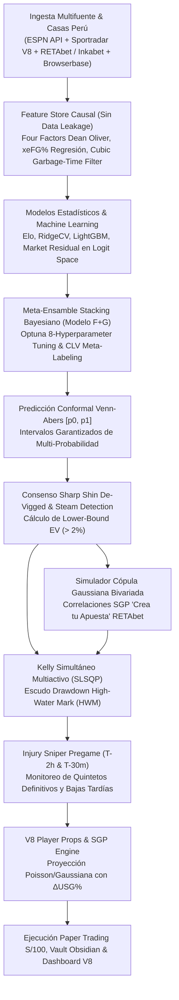

# NBA Betting Intelligence V8 — Institutional Quantitative Sports Analytics & SGP Syndicate

Sistema cuantitativo multiagente de predicción probabilística, calibración conformal, modelado residual de mercado en espacio logit, cópulas gaussianas para SGP y **paper trading exclusivo** para la NBA, coordinado secuencialmente en **Google Antigravity**.

> [!IMPORTANT]
> **Modo Exclusivo de Simulación / Paper Trading**: Este sistema opera bajo un entorno de gestión de riesgo con un bankroll virtual de **S/ 100.00 PEN**. No realiza apuestas reales con dinero fiduciario ni promueve el juego de azar; su fin es la investigación aplicada en modelado estocástico y finanzas cuantitativas.

---

## 🏛️ Arquitectura Cuantitativa V8



---

## 🧩 Módulos Cuantitativos Principales

1. **Dean Oliver Four Factors & xeFG% Luck Mean-Reversion**:
   * Seguimiento causal de las 4 métricas canónicas: $eFG\%$, $TOV\%$, $ORB\%$, y $FTR\%$.
   * Estimador $xeFG\%$ que descompone el porcentaje efectivo en calidad de tiro esperada ($3PA \text{ rate}$, $FTA \text{ rate}$) para filtrar rachas insostenibles de acierto exterior.
   * Filtro cúbico no lineal de *Garbage Time*: posesiones con margen $>18$ puntos son atenuadas hasta un factor de $0.50$, eliminando el ruido de las segundas unidades.
2. **Modelado Residual de Mercado en Espacio Logit & Meta-Labeling de CLV**:
   * En lugar de predecir la probabilidad pura desde cero, el modelo se ancla a la probabilidad libre de margen de casas *sharp* (Pinnacle/Circa) calculada mediante el algoritmo de Shin/Power: $z_{\text{sharp}} = \text{logit}(p_{\text{sharp}})$.
   * El modelo aprende únicamente el residual micro-estructural $\Delta z$, acotado mediante pérdida de Huber a $[-0.45, +0.45]$.
   * Clasificador de Meta-Labeling que predice $\mathbb{P}(\text{CLV} > 0)$ y bloquea apuestas con riesgo de decaimiento adverso antes del tip-off.
3. **Simulador de Correlaciones SGP mediante Cópulas Gaussianas Bivariadas**:
   * Motor Monte Carlo de 10,000 iteraciones que genera variables aleatorias correlacionadas según la matriz empírica NBA (ej. Moneyline Favorito $\leftrightarrow$ Puntos Anotador Principal $\rho \approx +0.35$).
   * Diseñado específicamente para explotar ineficiencias de parlay en el producto "Crea tu Apuesta" de **RETAbet Perú** y el mercado regulado local.
4. **Optimización de Portafolio Kelly con Escudo Drawdown (HWM Shield)**:
   * Optimización multiactivo convexa mediante `scipy.optimize SLSQP` para maximizar $\mathbb{E}[\ln(1 + \sum f_i R_i)]$.
   * Escudo High-Water Mark: cuando el capital sufre una racha negativa ($d = (\text{peak} - \text{current})/\text{peak}$), la fracción de Kelly y los topes de exposición máxima diaria se contraen automáticamente según $\text{hwm\_shield} = \max(0.40, 1.0 - 2.0 \times d)$ para preservar el bankroll.
5. **Predicción Conformal Venn-Abers (Vovk & Petej)**:
   * Intervalos multiprobabilísticos $[p_0, p_1]$ adaptativos con cobertura estadística garantizada.
   * Filtro riguroso de **Lower-Bound EV**: solo se colocan apuestas cuando la cota inferior del intervalo probabilístico mantiene un $+EV$ positivo.
6. **Injury Sniper Pregame Dual-Window (T-2h y T-30m)**:
   * Monitoreo automatizado en las dos ventanas críticas: T-120 min (*Injury Report* oficial de la tarde) y T-30 min (*Starting Five* confirmados en mesa técnica).
7. **Player Props Quantitative Engine**:
   * Modelado estocástico de Puntos (`PTS`), Rebotes (`REB`), Asistencias (`AST`) y `PRA` con redistribución de uso vacante ($\Delta\text{USG}\%$) y minutos ante bajas de titulares.

---

## ⚡ Ejecución Rápida

```powershell
# 1. Sincronizar dependencias en entorno virtual con uv
uv sync --extra dev --python 3.12

# 2. Ejecutar la suite completa de 39 pruebas unitarias (100% de éxito)
uv run pytest -q

# 3. Escanear monitor pre-partido de lesiones (T-2h y T-30m)
uv run python scripts/run_injury_sniper.py --mode auto

# 4. Escanear oportunidades en Player Props y Cópulas SGP RETAbet
uv run python scripts/run_player_props.py --min-ev 3.0

# 5. Capturar cuotas de casas peruanas (RETAbet, Inkabet, Betsson) en ventana T-6h
uv run python scripts/run_peru_odds_scraper.py

# 6. Re-entrenar modelos de Machine Learning (RidgeCV, LightGBM, Residual Logit)
uv run python scripts/train_models.py --version-tag v8

# 7. Ejecutar ciclo completo cloud de paper trading V8
uv run python scripts/run_cloud_cycle.py --mode auto
```

---

## 📊 Dashboard Interactivo V8 & Obsidian Vault

El sistema genera un panel interactivo institucional en `reports/dashboard.html` (y desplegado automáticamente en GitHub Pages) con:
- Monitor de apuestas activas y cuotas locales peruanas (PEN S/.)
- Proyecciones individuales de Player Props y correlaciones Same-Game Parlay (SGP)
- Curva de equidad institucional, drawdown tracking y calibración Brier Score
- Sincronización bidireccional con el vault Markdown de **Obsidian** con consultas dinámicas en **DataviewJS**.
