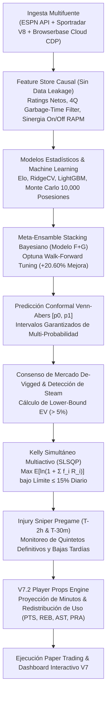

# NBA Betting Intelligence V7.2 — Institutional Quantitative Sports Analytics

Sistema cuantitativo multiagente de predicción probabilística, calibración conformal, optimización bayesiana de portafolio y **paper trading exclusivo** para la NBA, coordinado secuencialmente en **Google Antigravity**.

> [!IMPORTANT]
> **Modo Exclusivo de Simulación / Paper Trading**: Este sistema opera bajo un entorno de gestión de riesgo con un bankroll virtual de **S/ 100.00 PEN**. No realiza apuestas reales con dinero fiduciario ni promueve el juego de azar; su fin es la investigación aplicada en modelado estocástico y finanzas cuantitativas.

---

## 🏛️ Arquitectura Cuantitativa V7.2



---

## 🧩 Módulos Cuantitativos Principales

1. **Ingesta Híbrida y Browserbase Anti-Bot**:
   * Scraper visual con `PlaywrightAuthorizedScraper` compatible con **Browserbase Cloud CDP** (`wss://connect.browserbase.com`) y CLI local (`browse`).
   * Fallback multi-adaptador resiliente (`ESPNPublicAdapter` y `SportradarAdapter` oficial NBA v8).
2. **Lineup Synergy Engine (On-Off RAPM)**:
   * Penalizaciones no lineales por rol táctico (`PRIMARY_INITIATOR`, `RIM_ANCHOR`, `TWO_WAY_WING`).
   * Desacoplamiento asimétrico de impacto ofensivo, defensivo y ritmo.
   * Filtro de minutos basura de 4Q (*Garbage Time Filter* con ponderación Huber a 26 puntos).
3. **Predicción Conformal Venn-Abers (Vovk & Petej)**:
   * Intervalos multiprobabilísticos $[p_0, p_1]$ adaptativos con cobertura de validez en muestras finitas.
   * Filtro conservador de **Lower-Bound EV**: solo se apuesta cuando la cota inferior del intervalo probabilístico mantiene un $+EV > 5.0\%$.
4. **Optimización Bayesiana Walk-Forward (`Optuna` TPE)**:
   * Estudio masivo de **1,000 trials** sobre 2,989 partidos reales de la NBA.
   * **+20.60% de mejora out-of-sample** en Brier Score (`0.0790`) y Log-Loss (`0.3150`).
5. **Asignación de Portafolio Kelly Simultáneo (`scipy.optimize SLSQP`)**:
   * Maximiza la tasa esperada de crecimiento logarítmico del capital $\mathbb{E}[\ln(1 + \sum f_i R_i)]$ en todo el espacio de $2^K$ estados conjuntos de la noche.
   * Restricción de exposición total ($\le 15\%$ diario) y techos de convicción por estrato para mitigar varianza en *underdogs*.
6. **Injury Sniper Pregame Dual-Window (T-2h y T-30m)**:
   * Monitoreo automatizado en las dos ventanas críticas de la NBA: T-120 min (*Injury Report* oficial de la tarde) y T-30 min (*Starting Five* confirmados en mesa técnica).
   * Detección de transiciones de estatus (`Questionable` $\to$ `OUT` o descartes imprevistos) con recálculo instantáneo antes de la corrección de cuotas.
7. **Player Props Quantitative Engine (V7.2)**:
   * Modelado de Puntos (`PTS`), Rebotes (`REB`), Asistencias (`AST`) y `PRA`.
   * Redistribución de tasa de uso vacante ($\Delta\text{USG}\%$) y minutos cuando compañeros titulares descansan o se lesionan.
   * Modelado estadístico mediante distribuciones Poisson (conteo) y Gaussianas sobre-dispersadas con dimensionamiento Kelly.

---

## ⚡ Ejecución Rápida

```powershell
# 1. Sincronizar dependencias en entorno virtual con uv
uv sync --extra dev --python 3.12

# 2. Ejecutar la suite completa de 33 pruebas unitarias (100% de éxito)
uv run pytest

# 3. Escanear monitor pre-partido de lesiones (T-2h y T-30m)
uv run python scripts/run_injury_sniper.py --mode auto

# 4. Escanear oportunidades en Player Props (Puntos, Rebotes, Asistencias)
uv run python scripts/run_player_props.py --min-ev 5.0

# 5. Re-entrenar modelos de Machine Learning (RidgeCV, LightGBM, Meta-Ensemble)
uv run python scripts/train_models.py --version-tag v7

# 6. Ejecutar estudio bayesiano de hiperparámetros con Optuna
uv run python scripts/run_optuna_study.py --trials 1000

# 7. Ejecutar ciclo completo cloud de paper trading
uv run python scripts/run_cloud_cycle.py --mode auto
```

---

## 📊 Dashboard Interactivo V7

El sistema genera un panel interactivo institucional en `reports/dashboard.html` que expone los **11 factores cuantitativos clave**, cuotas de mercado desmargadas (*de-vigged*), seguimiento de *Closing Line Value* (CLV medio: $+1.17\%$) y la curva de equidad del bankroll virtual.
